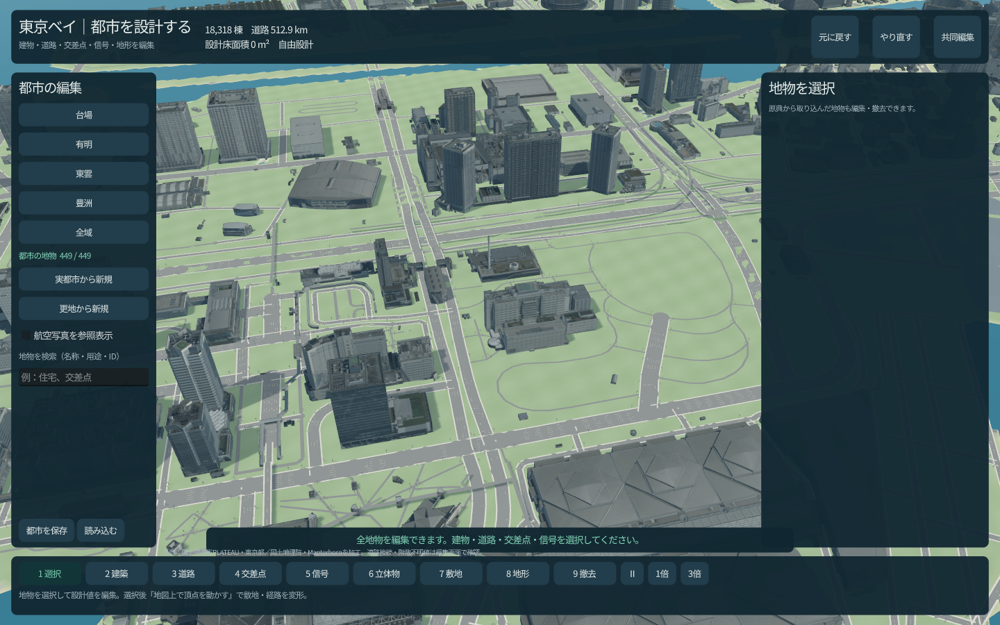

# 都市づくり

Godot .NET で制作する、オンライン共同編集に対応した都市づくりゲームです。台場・有明・東雲・豊洲を含む東京湾岸の公的データを初期都市として使い、**原典の建物・道路も一つずつ変更・移動・撤去**できます。建物の階数・敷地、道路の車線、交差点の接続、信号現示、地形を設計し、住宅と目的地を交通網で結ぶと住民と乗り物が移動します。



ゲーム名は「都市づくり」、都市名はセーブデータごとにプレイヤーが指定します。「東京ベイ」も任意の都市名として使用できます。内部の地図ID・アセンブリ名などに残る `Bayfront` は既存データとの互換用です。

## 起動

この環境には Godot 4.7.2 .NET と .NET 8 SDK を設定済みです。リポジトリのルートで実行します。

```powershell
.\run.ps1
```

エディターは `run.ps1 -Editor`、Vulkan が使えない端末では `run.ps1 -Compatibility` を使います。既定のエンジンは `S:\Godot_v4.7.2-stable_mono_win64\Godot_v4.7.2-stable_mono_win64.exe`、SDK は `%LOCALAPPDATA%\Microsoft\dotnet` です。別の環境で SDK がない場合は `setup.ps1` を実行してください。

大容量の描画データは Git の対象外です。初回または個別編集用の旧キャッシュを更新する場合は次を実行します。

```powershell
.\import-world.ps1
```

取り込み済みデータだけを通信せず検査する場合は `import-world.ps1 -SkipDownload` を使います。建物 GLB 216 件と、それぞれの三角形を建物 ID へ対応付ける地物対応表 216 件の SHA-256 まで確認します。ゲーム実行時に Node.js・Python・地図サービス・MCPへの接続は不要です。

通常の取り込みは建物写真の2K表示用キャッシュも準備し、初回起動の大きな画像展開・縮小を済ませます。省略する場合は `-SkipTextureCache` を指定できます。原典GLBと元写真は保持します。

別の Godot を使う場合は `run.ps1 -GodotPath <実行ファイル>` と `NuGet.Config` のローカルパッケージ設定を変更します。通常の描画設定は Forward+、4倍MSAAです。

## 都市を作る

上部の「都市・セーブ」から新しい都市を作成します。「実都市から新規」は公開データを初期配置として取り込みます。「更地から新規」は同じ地形と水面だけを残し、建物・道路・交差点・信号をゼロから設計します。「交通の試験街区を新規作成」は、実地形の海岸に住宅・職場・駅・港と四交通手段の接続を置きます。これらも全て編集・撤去できます。現在の都市を置き換える前に確認画面を表示します。

更地・交通の試験街区では、原典を非表示にしている間は建物GLBを読みません。原典を有効にすると未読タイルから読み込みを始め、再び無効にすると残りの読み込みを休止します。CPU用の都市データと地形は別に読み込みます。試験街区の初期視点は街区全体を収め、地形・地物の準備中は画面に進捗を表示します。

建設ツールは画面下部、選択・移動・回転・高さは左上、選択した地物の設定は右側へ配置しています。右側の「設計」「形状」「運用」を切り替えて設定します。地区移動・地物検索・航空写真は上部の「地図・検索」から開きます。

固定背景として撤去できない建物・道路はありません。未変更の原典建物は元の屋根・壁・写真を維持し、個別の形状変更時はその建物の原典三角形だけを外し、入力した設計値から再生成します。名称や用途だけの変更では元の詳細形状を維持します。

| 対象 | 編集項目 |
| --- | --- |
| 建築 | 位置、回転、用途、幅・奥行、敷地頂点、階数・階高、階数未設定時の高さ、屋根、色、材質名、地形への追従 |
| 道路・線路・航路 | 複数点の中心線、用途、順逆方向の車線数、車線幅、歩道幅、制限速度、高さ、立体交差の層 |
| 交差点 | 位置・広さ、接続道路、優先・一時停止・信号・環状の制御設定 |
| 信号 | 所属交差点、進入道路、現示ごとの青時間と許可道路、黄時間・全赤時間・周期の時差 |
| 立体物・敷地 | 寸法・高さ・色、任意の敷地頂点、地表への追従 |
| 地形 | 盛土、掘削、指定標高への整地、平滑化、ブラシ半径・変化量、水面高、初期地形への復元 |

敷地・道路の頂点は数値入力と地図上のドラッグで編集できます。道路は地図を複数回クリックして経路を作り、Enterで確定します。同じ高さ階層の接続点を作成する設定と、接続道路を手動指定する操作があります。信号を設定すると、指定した現示と秒数に従って灯色が変わります。

地物は屋根と壁の両方から選択できます。未変更の原典建物は表示に使う三角形、変更後の建物は回転・凹形輪郭を含む立体形状で判定します。道路は地形上の帯、信号は柱・横桁・灯器を個別に検査し、手前の地物を優先します。選択フィルターで建物、道路・線路・航路、交差点、信号、人・乗り物へ絞れます。

原典に階数がない建物は **0＝未設定** と表示し、元の形状高を使います。階数を設定すると `階数 × 階高` が設計高さになります。敷地と階数から延床面積・設計定員・概算費用を計算します。これらは実在人口・実工事費を表す値ではありません。

道路の初期車線・速度・高架高、道路形状から生成した交差点・信号器の位置はゲーム用の推定です。実際の車線数、信号設置場所、現示の公的確定データではありません。推定した信号には実際の青時間を割り当てず、利用者が設定します。

航空写真は通常表示しません。撤去した建物や道路の写真が地面に残るのを防ぎます。左側の「航空写真を参照表示」で、必要なときだけ参照できます。地形の海底補正、精度、描画解像度は [編集地形](docs/編集地形.md) に記載しています。

## 操作

| 操作 | 入力 |
| --- | --- |
| カメラ移動 | WASD、方向キー、中ボタンドラッグ |
| 視点回転 | Q / E、右ボタンドラッグ |
| 拡大・縮小 | ホイール |
| 地区へ移動 | 「地図・検索」の地区ボタン |
| ツール | 1 選択、2 建築、3 道路、4 交差点、5 信号、6 立体物、7 敷地、8 地形、9 撤去 |
| 地物の編集 | 左クリックで選択し、右側の設計値を入力して反映 |
| 地物の移動 | 「移動」または G を選び、対象の地物を左ドラッグ |
| 地物の回転 | 「回転」または R を選び、対象の地物を左右へ左ドラッグ |
| 地物の上下 | 「高さ」または H を選び、対象の地物を上下へ左ドラッグ |
| 細かい移動・回転・上下 | ドラッグ中に Shift。水平・上下は0.1m、回転は1度刻み |
| 個体の選択 | 近づいて人・乗り物を左クリック、または「人・交通」の一覧から選択 |
| 選択個体の追跡 | 右側の「追う」。もう一度押すと追跡解除 |
| 道路の確定 | 経路を2点以上指定して Enter |
| 頂点の変更 | 「地図上で頂点を動かす」を選び、水色の頂点をドラッグ |
| 地形の編集 | 8を選び、半径・処理・高さを指定して左ドラッグ |
| 選択地物の撤去 | Delete または撤去ボタン |
| 取消・やり直し | Ctrl + Z / Ctrl + Y、上部ボタン |
| 作図・編集モード解除 | 右クリックまたは Esc |
| 都市の保存 | Ctrl + S または「都市を保存」 |

ドラッグ中は変更案を表示し、左ボタンを離すと確定します。移動・回転・上下も取消・やり直しと共同編集の対象です。道路の回転は折れ線全体へ適用し、交差点の移動では接続道路と所属信号の位置を連動させます。

## 目的地を持つ住民と交通

建物の「用途」を住宅と職場・商業・公共施設などへ設定し、階数を指定すると、床面積に応じた段階的な入居と目的地への移動を計算します。階数0の原典建物へ架空の住民を自動配置する処理はありません。設計定員と実入居者数は別に保持します。

| 手段 | 必要な接続 |
| --- | --- |
| 徒歩 | 住宅と目的地を結ぶ歩道付き道路 |
| 自動車 | 車線があり、通行方向に沿って目的地へ到達できる道路 |
| 鉄道 | 乗降する2か所以上の駅、接続した線路、住宅・目的地と各駅を結ぶ歩道 |
| 船 | 乗降する2か所以上の港、接続した航路、住宅・目的地と各港を結ぶ歩道 |

住宅の用途選択で希望する交通手段を指定できます。住民は固定の住居・職場と、買物・余暇の訪問先、現在の滞在先を別に保持し、通勤・買物・余暇・帰宅の目的と経路を持ちます。店舗は職場と買物先、公園は訪問先として扱います。接続の分断や施設の不足では待機理由を表示し、道路の通行方向、赤信号、先行車待ちを反映します。

住民・車・電車・船をクリックすると状態、住居・職場・滞在先、今回の目的・起終点、残り経路、乗員・乗客数を確認できます。住居などの関連先や車両の乗員へ選択を移せます。個体の経路表示と追跡はそれぞれ切り替えられ、手動の視点移動でも追跡を解除します。屋内滞在中・乗車中の人は屋外へ重複表示しません。

最初は「都市・セーブ」から交通の試験街区を作り、時間を進めて「人・交通」から個体を選ぶと確認できます。駅・港・線路・航路や住宅の設定を変更して、移動できる経路と待機理由の変化を試せます。

個別計算は都市全体で最大512人、稼働状態は住民と乗り物を合わせて最大1,024件です。列車と船は目的を持つ旅客から生成する試作で、複数旅客が共有する定期便、運行ダイヤ、乗換計画、貨物物流は未実装です。詳細な車線変更・駐車・運賃・経済・電気・水道も未実装で、実都市全人口の交通を再現する段階ではありません。[目的交通と編集操作](docs/目的交通と編集操作.md) に現状の処理と制約を記載しています。

## 共同編集とデータの所有

都市データを持つ人が保存を読み込み、「共同編集」からその都市のホストになります。参加者はホストの IP アドレスと UDP ポートを入力します。プレイヤーホスト方式はホストを含め最大8人です。中央専用サーバーを起動した場合は、そのサーバーが都市の正本を持ち、最大7人のクライアントが参加します。

建物・道路・交差点・信号の設計変更、撤去、地形、水面高をホストが検証して確定し、全員へ同期します。各要求には期待する版番号を付け、古い版に基づく要求は競合として拒否します。元の建物メッシュや写真を編集のたびに送る方式ではありません。

都市時計と交通の稼働状態は設計の版番号から分離しています。時間や交通の進行だけでは編集要求を競合させず、時計の小さな通知と交通状態の圧縮通知で約1秒間隔に同期します。停止・速度の変更と都市名の変更はホストが行います。経過秒・端数・住民・移動経路を保存し、読み込み後も都市時間と行動を継続します。編集の取消・やり直しでは時計を巻き戻しません。

- **参加者は共有都市を保存・読み込み・再ホストできません。** 共有都市は参加中のメモリー上だけで保持します。
- 切断時は共有都市を破棄し、参加前の自分の都市へ戻ります。ホスト移譲は行いません。
- 保存できるのはソロ・プレイヤーホスト、または中央専用サーバーです。
- 編集履歴の取消・やり直しもホスト上で確定し、共有状態へ反映します。履歴自体は現在の実行中だけ保持し、保存ファイルへは確定した編集状態を記録します。

同じPCならゲームを2つ起動し、`127.0.0.1` と **UDP 24567** で接続できます。LANではホストのLANアドレスを使います。インターネット接続にはUDPポート転送またはVPNなどの相互接続が必要です。ルーム検索・自動中継・アカウント認証は未実装です。

GPUなし Linux 向けには `export-server.ps1`、Windowsで専用モードを試す場合は `run-server.ps1` を使います。サーバーは計算用JSON、地形ブラシ、目的交通、同期と保存を扱い、建物メッシュ・写真・画面を生成しません。Windowsの描画なし動作とLinux向け配布物の生成を検証しています。Linux実機・WSL・Docker上の実行は未検証です。[専用サーバー](docs/専用サーバー.md) に配布と運用例を記載しています。

## 保存

ソロ・プレイヤーホストは「都市・セーブ」で都市名を変更し、「別のセーブとして保存」で独立した保存を作成できます。Ctrl + S または「都市を保存」は現在の保存先を更新し、未保存都市では新しい保存を作成します。保存一覧から都市名と更新日時で選んで読み込みます。

都市名は1～80文字で制御文字を含められません。ファイル名には都市名を使わず、内部の保存識別子を使います。標準の保存先は `user://cities/saves/<保存識別子>.json`、Windowsでは次の場所です。

```text
%APPDATA%\Godot\app_userdata\都市づくり\cities\saves\<保存識別子>.json
```

都市名、原典を含める設定、地物の変更・新設・削除、地形ストローク、水面高、都市時計と速度、実住民・目的地・個体の経路と移動途中の状態を保存します。大容量の原典そのものは同じ地図ID・版の基礎データとして別に配布します。過去の保存に含まれる追加施設・道路も編集可能な地物へ移行します。

保存は `.tmp` を経由して置き換え、前回分を `.bak` に残します。「読み込む」は現在の都市を保存内容へ置き換え、ホストの場合は参加者にも反映します。ゲーム画面側の自動保存はまだありません。専用サーバーには定期保存と正常終了時保存があります。

旧単一保存 `user://cities/real-bayfront.json` と、旧アプリ名の保存フォルダーにある同名ファイルも一覧から読み込めます。旧形式で都市名の項目がない保存は「名前未設定の都市」と表示します。型や長さが不正な都市名、壊れたJSONは一覧から除外します。旧簡略地図の保存は `bayfront.json` として分離し、地図ID・版が違う都市の読み込みや同期は拒否します。旧画面を確認する場合は `run.ps1 -Sample` を使います。

## 使用している公的データ

| 対象 | 内容 |
| --- | --- |
| 建物 | PLATEAU 東京都2025年度、18,318棟・216 GLB、約127万三角形 |
| 詳細度 | LOD2 9,229棟、LOD1 9,089棟。写真テクスチャあり170タイル |
| 個別編集 | 全216タイルの三角形と建物IDの対応表。変更・撤去時は対象建物の三角形だけを更新 |
| 地表参照写真 | PLATEAU-Ortho と地理院写真。z18元写真3,136枚、約0.49m／画素、196アトラス |
| 土地・道路 | 地理院Vectorの陸地111面、道路中心線11,004区間、海岸線491区間 |
| 高さ | 国土地理院DEM由来の楕円体高を建物と共通の局地座標へ変換 |
| 範囲 | 東経139.760〜139.830、北緯35.610〜35.670 |

原点は東経139.795・北緯35.640・楕円体高0mです。WGS84 ECEFから倍精度でENUへ変換し、Godot内はX東・Y上・Z南、1単位10mで統一しています。数値精度と元測量の精度は異なり、全棟が最新・写真付き・測量用途の精度を備えるわけではありません。[実データ構成](docs/実データ構成.md) に原典、年度、再取得、利用条件と制約を記載しています。

## 検証

```powershell
.\test.ps1
```

ビルド・Godotの取込、モデル検証、複数都市の保存復元、地物の移動・回転・上下と深い複製、壁・凹形・信号灯の選択、実地形ブラシ、原典の個別編集・撤去、道路・交差点・信号、取消・やり直しを検証します。四交通手段の目的移動、接続分断、赤信号、個体表示・選択、保存再開も検査します。

実ENetの2プロセスで編集・時計・交通・都市名の同期と参加者の所有権を確認し、描画ノード数0の専用サーバーで永続化を検証します。同じ編集版の断片転送、異なる地図と破損保存の拒否も含みます。旧画面の `InteractionTest` と新画面の `UrbanInteractionTest` の両方で入力経路を確認し、既存保存は試験前後に退避・復元します。ログは `.godot/test-logs` に保存します。

2026年10月16日のWindows GPU画面では、試験街区の全体表示、停止中の交通一覧、住民の胴体選択、車→実乗員→住居の選択、建物の正面壁選択、移動・回転・上下ドラッグ、取消、盛土を実操作で確認しました。原典を非表示にした16地物の街区は、原典GLB読込0件、地物描画準備ログ918msでした。修正前の同ログ114,789msとの比較で、アプリ全体の起動時間を測った値ではありません。操作の確認範囲と未実装部分は [目的交通と編集操作](docs/目的交通と編集操作.md) に記載しています。

`test.ps1 -Play` は成功後にゲームを開きます。新画面だけの入力試験はGodot起動引数 `-- --urban-interaction-test`、旧画面は `-- --interaction-test` です。

## 構成

| ファイル | 役割 |
| --- | --- |
| `Scripts/Main.cs` / `Scripts/CityGame.cs` | 起動経路、全地物の編集操作と保存・共同編集 |
| `Scripts/UrbanHud.cs` / `Scripts/OrbitCamera.cs` | 日本語の設計画面と俯瞰カメラ |
| `Scripts/UrbanModel.cs` / `Scripts/CityModel.cs` | 編集DTO、検証、信号現示、設計集計、都市状態とJSON |
| `Scripts/UrbanCatalog.cs` | 原典建物・道路・推定交差点と信号を編集可能な初期都市へ変換 |
| `Scripts/UrbanRenderer.cs` / `Scripts/UrbanSourceMeshes.cs` | 原典三角形の個別識別、変更形状、道路と信号灯の描画 |
| `Scripts/UrbanTransform.cs` / `Scripts/CitySaveStore.cs` | 地物の一体変換、都市名に依存しない複数保存 |
| `Scripts/UrbanSimulation.cs` / `Scripts/SimulationModel.cs` | 実住民、目的地、四手段の経路探索と待機・到着 |
| `Scripts/UrbanAgentRenderer.cs` / `Scripts/UrbanDemo.cs` | 住民と乗り物の表示・選択、編集可能な交通試験街区 |
| `Scripts/EditableTerrain.cs` | CPU地形関数、局所地形メッシュ、参照写真 |
| `Scripts/CollaborationSession.cs` / `Scripts/DedicatedServer.cs` | ホスト権威の同期、所有権と描画なし専用サーバー |
| `Data/RealWorld/` / `Scripts/RealWorldData.cs` | 原典の計算用地理データ |
| `Tools/ImportPlateau/` / `Tools/ImportGround/` | 再取得と変換、地物・三角形対応表の生成 |
| `Scripts/SmokeTest.cs` / `Scripts/EditableTerrainTests.cs` | モデル・地形・通信の検証 |
| `Scripts/UrbanInteractionTest.cs` / `Scripts/InteractionTest.cs` | 新設計画面と旧画面の操作検証 |

## 現段階

建物や道路を固定背景から編集可能な都市へ変更し、自由な寸法・敷地・階数、道路・交差点・信号の設計、地形造成と共同編集を実装しています。初期都市の原典には実測・推定・未設定の値が混在し、その違いを説明と入力欄へ残しています。

住宅からの段階入居と、徒歩・自動車・鉄道・船による目的地への移動を実装しています。接続・通行方向・信号・先行車が実際の移動へ影響し、個体の情報表示と追跡ができます。計算上限と単純化を持つ最初の交通実装で、実都市の需要推計、共有ダイヤ・多数乗客、貨物、電気・水道、経済、災害、区画の自動成長は今後の対象です。公開運用向けの招待・細かな編集権限・中継も未実装です。

2026年10月16日のCities: Skylines II実機操作では、道路と住宅区画の新設・建設進行、供給不足と接続後の表示変化に加え、住民追跡と徒歩経路、バンの所有者・運転者・乗客、鉄道路線一覧から列車個体の追跡、施設本体と付属施設をまとめた移設・回転、地形の盛土・平滑化を確認しました。使用都市にはMODが含まれ、列車と施設の一部は追加コンテンツです。欠損prefabによる表示・操作不良をゲーム本来の仕様として扱いません。本プロジェクトでは車両所有者と運転者の分離、施設群の一括移設、共有ダイヤは未実装です。

開発では、編集可能な建物の床面積・用途から求める定員と、実際の入居者・到着を分けています。次の対象は、通勤・配送の到着を稼働率・生産・収益へつなげることと、電気・上下水道の不足量と供給経路を追えることです。現行の交通到着や設計集計だけで経済・供給網まで再現しているわけではありません。

## 同梱素材

建物・地形・参照写真は国土交通省PLATEAU・東京都・国土地理院・Mapterhornの公開データを加工しています。出典・取得条件・加工内容は [実データ構成](docs/実データ構成.md) に記載しています。地物の変更形状、アイコン、旧簡略地図は本試作用に作成しています。

日本語フォント Noto Sans CJK JP のライセンスは [OFL.txt](Assets/Fonts/OFL.txt)、配布元は [Noto CJK](https://github.com/notofonts/noto-cjk) です。Godot等の著作権表示は `Assets/Licenses/` に同梱します。
